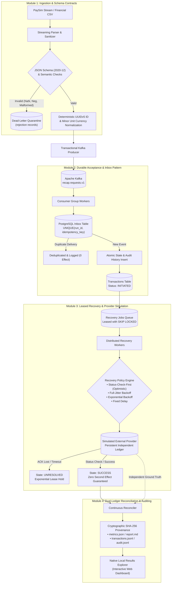

# RECAP — Realtime Event Consistency & Dual-Ledger Audit Platform

[](https://www.python.org/)
[-231F20?logo=apachekafka&logoColor=white)](https://kafka.apache.org/)
[](https://www.postgresql.org/)
[](https://www.sqlalchemy.org/)
[](https://www.docker.com/)
[](tests/)
[](LICENSE)

> **High-throughput distributed financial consistency engine ensuring zero duplicate payments, deterministic idempotency, leased recovery, and dual-ledger continuous reconciliation under network partitions and payment provider timeouts.**

---

## 📌 Executive Summary & Problem Statement

In distributed fintech architectures, payment gateway timeouts and dropped network responses create severe consistency hazards:
* **The Fallacy of Naive Retries**: If a payment provider processes a credit request but drops the HTTP `200 OK` acknowledgment, retrying the operation blindly results in **duplicate charges (double debiting)**.
* **The Pitfall of False Failures**: Marking an ambiguous timeout as `FAILED` violates real-world truth if the bank eventually commits the ledger entry.
* **Core Architectural Principle**: In **RECAP**, **`UNRESOLVED ≠ FAILED`**. Timed-out requests enter a non-terminal, durable `UNRESOLVED` state, handled via deterministic idempotency keys, atomic transactional outboxes, distributed row leases, and continuous dual-entry ledger reconciliation.

---

## 🏗️ System Architecture



---

## 🚀 Key Engineering Highlights

| Capability | Engineering Implementation |
|---|---|
| **Deterministic Idempotency** | Stable SHA-256 idempotency hashing combined with UUIDv5 namespace derivation ensures identical transactions across re-deliveries collapse into a single database effect. |
| **Durable Inbox Pattern** | PostgreSQL `UNIQUE(run_id, idempotency_key)` constraints guarantee atomic deduplication at database level, protecting downstream services from duplicate Kafka events. |
| **Leased Recovery Workers** | Distributed queue workers lock jobs using `FOR UPDATE SKIP LOCKED` and configurable lease timeouts (30s), ensuring crash resilience without split-brain execution. |
| **Optimistic Status-Check Policy** | Proactively queries provider state *before* initiating retries (`status_check_first`), eliminating redundant network writes and duplicate processing. |
| **Zero Loss Source Quarantine** | Strict JSON Schema (2020-12) validation flags corrupt fields, negative amounts, and date anomalies into a durable rejection log without interrupting pipeline throughput. |
| **Dual-Ledger Reconciliation** | Automatically audits internal transaction records against independently committed provider ledgers, verifying 100% agreement and logging balance anomalies. |
| **Native Zero-Dependency UI** | Local browser explorer (`recap.dashboard`) serving transaction filters, audit timelines, edge-case evaluations, and report downloads. |

---

## 📊 Empirical Evaluation & Benchmark Results

Verified on **1,000 real PaySim financial transaction rows** + **17 boundary edge cases** running over live **Apache Kafka (KRaft)** and **PostgreSQL 17.6**:

| Metric | 1,000-Row PaySim Run (Full Failure Mix) | 17-Case Input Boundary Run |
|---|:---:|:---:|
| **Source Rows Read** | `1,000` | `17` |
| **Accepted vs. Quarantined** | `1,000 Accepted` / `0 Rejected` | `7 Accepted` / `10 Rejected` |
| **Wire Events Processed** | `1,149` (includes 149 duplicate re-deliveries) | `7` |
| **Duplicate Provider Effects** | **`0` (Zero Duplicate Charges)** | **`0`** |
| **Final Transaction State** | `740 SUCCESS` / `137 FAILED` / `123 UNRESOLVED` | `7 SUCCESS` / `0 FAILED` |
| **Recovery Resolution Rate** | **`79.5%` (477 of 600 uncertain events recovered)** | `100%` |
| **Dual-Ledger Reconciliation Agreement** | **`100.0%` Match Rate** | **`100.0%` Match Rate** |
| **Total Audit History Records** | `7,784` atomic state transitions | `28` |

### Systematic Edge Case Handling

| Input Edge Case | Platform Behavior | Invariant Enforced |
|---|---|---|
| **Negative / Overflow Amount** | Quarantined at Ingestion Stage | Rejection ledger written; Kafka never polluted |
| **Corrupt Date / Non-numeric Step** | Schema Validation Failure | Dead-letter logged with specific JSON Path error |
| **Fractional Cents (`$2.345`)** | Deterministic Half-Up Rounding | Exact integer math (`235 minor units`) prevents float drift |
| **Source Balance Inconsistency** | Accepted & Flagged in Audit | Source data anomalies tracked without aborting valid payments |
| **Omitted Merchant Balances** | Handled Gracefully | Destination balance marked as `UNAVAILABLE` |
| **Dropped Provider ACK** | Transitioned to `UNRESOLVED` | Status-check reconciles with provider; 0 duplicate charges |

---

## 🛠️ Tech Stack & Prerequisites

* **Core Runtime**: Python 3.11+ (Tested on 3.11, 3.12, 3.13)
* **Message Broker**: Apache Kafka 4.1.0 (Single-node KRaft mode)
* **Database & ORM**: PostgreSQL 17.6 Alpine, SQLAlchemy 2.0.44, psycopg 3.2.12 (binary)
* **Data Contracts**: JSON Schema 2020-12 (`referencing`, `jsonschema`)
* **Testing & Quality**: pytest 8.4.2 (106 unit & integration tests), pytest-cov, ruff
* **Containerization**: Docker Compose v2 (Kafka, PostgreSQL, workers, app)

---

## ⚡ Quickstart Guide

### 1. Installation

Clone repository and initialize virtual environment:

```powershell
# Windows PowerShell
git clone https://github.com/Vinamra3215/Realtime-Event-Consistency-and-Audit-Platform.git
cd Realtime-Event-Consistency-and-Audit-Platform

python -m venv .venv
.\.venv\Scripts\Activate.ps1
python -m pip install --upgrade pip
python -m pip install -e ".[dev]"
```

*(On Linux / macOS: `source .venv/bin/activate`)*

---

### 2. Portable Demonstration (No Docker / Kafka Required)

Run a complete simulation immediately using SQLite and in-memory direct transport:

```powershell
python -m recap.cli --database-url sqlite:///outputs/demo.db simulate --csv tests/fixtures/paysim_sample.csv --output outputs/demo --limit 100 --ui
```

*This will ingest sample transactions, simulate network delay/timeouts, perform recovery, reconcile outcomes, and automatically launch the Results Dashboard at `http://127.0.0.1:8765`.*

---

### 3. Production Multi-Service Run (Docker + Kafka + PostgreSQL)

```powershell
# 1. Initialize environment credentials & start backing services
python -m recap.cli init-env
docker compose up -d --wait postgres kafka

# 2. Run migrations, topic provisioning, and connectivity check
python -m recap.cli migrate
python -m recap.cli topics
python -m recap.cli doctor

# 3. Execute Kafka-backed simulation with Status-Check-First recovery
python -m recap.cli simulate --csv tests/fixtures/paysim_sample.csv --output outputs/kafka-demo --transport kafka --policy status_check_first --limit 100 --ui
```

---

### 4. Interactive Results Explorer & Comparative Dashboard

Launch or inspect saved runs at any time:

```powershell
# Inspect and compare runs side-by-side
python -m recap.cli dashboard --output outputs/paysim-original-1000 --compare-output outputs/paysim-input-edges
```

*Dashboard Features:*
* **Multi-Run Comparison**: Toggle between large PaySim datasets and edge-case validation slices.
* **Audit Timeline**: View granular step-by-step state machine transitions (`INITIATED` ➔ `PROCESSING` ➔ `UNRESOLVED` ➔ `SUCCESS`).
* **Artifact Downloads**: Export cryptographically verified `metrics.json`, `transactions.jsonl`, `audit.jsonl`, and `provenance.json`.

---

## 🧪 Testing & Verification Suite

```powershell
# Run full unit testing suite (106 tests)
python -m pytest tests/unit -v

# Run live PostgreSQL integration tests (requires Docker services)
python -m pytest tests/integration --live -v

# Run live Kafka end-to-end pipeline tests
python -m pytest tests/end_to_end --live -v

# Code quality and formatting inspection
python -m ruff check src tests
python -m ruff format --check src tests
```

---

## 📂 Repository Directory Layout

```text
├── config/                     # Configuration and failure profiles
│   ├── app.yaml                # Default application runtime settings
│   ├── edge_cases.yaml         # Balanced failure profile (timeouts, drops, delays)
│   └── input_edges.yaml        # Input validation boundary cases
├── migrations/                 # PostgreSQL versioned DDL schemas
│   └── 001_initial.sql         # Tables, indexes, uniqueness, and constraints
├── schemas/                    # JSON Schema 2020-12 data contracts
│   ├── transaction_event.schema.json
│   └── dead_letter_event.schema.json
├── src/recap/                  # Core platform implementation
│   ├── ingestion.py            # PaySim stream normalization & UUIDv5 identity
│   ├── streaming.py            # Kafka producer / consumer with manual commit
│   ├── database.py             # SQLAlchemy models, migrations, & atomic inbox
│   ├── recovery.py             # Leased workers & backoff recovery policies
│   ├── reconciliation.py       # Dual-ledger audit & anomaly detection
│   ├── dashboard.py            # Native results web explorer server
│   ├── demo_data.py            # Synthetic PaySim & edge case fixture generator
│   └── cli.py                  # Single CLI entry point
├── tests/                      # Automated test suites
│   ├── unit/                   # State machine, ingestion, recovery, & dashboard tests
│   ├── integration/            # Real PostgreSQL concurrency & lease tests
│   ├── end_to_end/             # Full Kafka pipeline tests
│   └── fixtures/               # Sample demonstration datasets
├── docker-compose.yml          # Multi-container Kafka, Postgres, & worker setup
└── pyproject.toml              # Build configurations and dependency definitions
```

---

## 👥 Contributors & Academic Context

Developed as an academic prototype in **Data Engineering & Distributed DBMS** by **Team 25**.
* Vinamra Gupta
* Darsh Choudhary
* Gurtej Singh
* Devang Shukla
